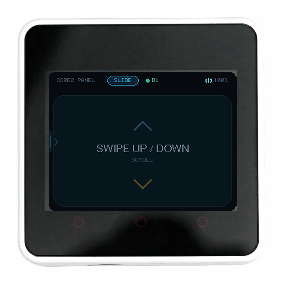
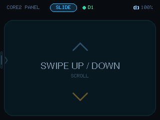
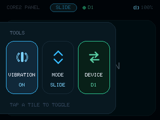
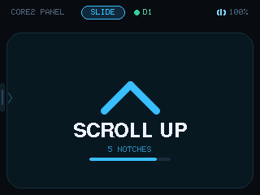
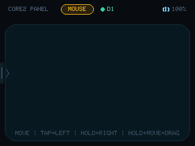

# Core2Keypad

M5Stack Core2 as a Bluetooth trackpad: the whole screen is the input area, no physical buttons.
Swipe up and down to scroll, press and drag to move the pointer; the left drawer switches modes,
toggles haptics, and selects which of up to three connected hosts receives the input.



[中文说明](README.zh-CN.md)

## Modes

| Mode | Swipe up / down | Tap | Hold 500 ms | Hold ~0.3 s, then drag |
| --- | --- | --- | --- | --- |
| **SLIDE** | wheel: swipe down scrolls up, swipe up scrolls down (natural scrolling) | — | — | — |
| **MOUSE** | move the pointer | left click | right click | left-button drag (select text, move windows) |

One wheel notch per 24 px of travel, at most 12 per swipe, sent while you move; the on-screen hint
stays for 3 s after you stop. Pointer sensitivity: **1 screen pixel ≈ 1.2 mouse counts**.

> Dragging and moving are told apart by a short pause: press and move straight away and the pointer
> just moves; hold for about 0.3 s before moving and the left button is held down until you lift.

## Toolbar

Swipe in from the left edge (x < 16, at least 60 px) to pull out the drawer:

- **VIBRATION** — haptics on/off, lit when on
- **MODE** — SLIDE / MOUSE, the colour follows the mode (blue = slide, amber = mouse)
- **DEVICE** — current host slot `D1/D2/D3`, lit when that slot is online; **tap to cycle**

Each tile is 64×106 and fully tappable; tap a tile to toggle, tap outside the drawer to close.
Everything is stored in NVS and survives a reboot. With haptics on, a scroll, left click or right
click gives a 40 ms buzz, and a small vibration icon sits to the left of the battery.

## Multiple hosts (3 slots)

The ESP32 BLE controller supports **three simultaneous connections**
(`CONFIG_BTDM_CTRL_BLE_MAX_CONN=3`), so there are exactly three slots:

- slots are keyed by Bluetooth address in NVS, so the mapping and the selection survive reboots and deep sleep
- `DEVICE` shows the current slot; **tapping cycles** D1 → D2 → D3 → D1
- **only the selected slot receives reports**; the other connections stay up — switching never disconnects
- the status bar always shows `● D<n>`: green = that slot is online, amber = that slot is offline but
  another host is online, grey = nothing is connected
- an empty or offline slot silently drops reports and never jumps to another device on its own
- a second or third host takes a free slot; when all three are taken, the least recently used offline slot is evicted

## Screenshots

| Slide mode (idle) | Drawer: VIBRATION / MODE / DEVICE |
| --- | --- |
|  |  |

| Swiping (wheel hint, hides after 3 s) | Mouse mode |
| --- | --- |
|  |  |

## Screen

The status bar holds the title, the mode chip (blue SLIDE / amber MOUSE), the current host slot
`● D1` and the battery; a small vibration icon appears when haptics are on.

- the bottom of the panel hints at the gestures; a swipe replaces it with direction, notch count and a progress bar for 3 s
- after 3 s idle the backlight fades to 20 %, and any touch brings it back immediately
- after 5 min idle the screen turns off and the CPU drops to 80 MHz; 5 min later the board enters deep sleep, and a touch wakes it
- a short press of the side power button enters deep sleep right away; a long press is still the AXP hardware power-off

## Serial console (921600)

| Command | What it does |
| --- | --- |
| `C2_INFO` | version, mode, haptics, connection count, slot, drawer state, boot count, uptime |
| `C2_BLE` | BLE server, HID service handle, connection state |
| `C2_CCCD` | subscription bits of the two input reports (`0100` = subscribed) |
| `C2_MODE <0\|1>` | 0 = SLIDE, 1 = MOUSE |
| `C2_VIB <0\|1>` | haptics on/off |
| `C2_BUZZ` | buzz once; `ok=1` means the motor is wired up |
| `C2_DISC` | drop the link of the current slot (for reconnect tests) |
| `C2_HOSTS` | list live connections: conn / slot / address / active |
| `C2_HOST <1\|2\|3>` | select a slot directly |
| `C2_T <0\|1> <x> <y>` | inject a touch; `C2_T 9` hands control back to the panel |
| `C2_SCREEN` | full-screen RGB888 capture (`tools/c2_screenshot.py` saves it) |
| `C2_SLEEP` | enter the first sleep stage now |
| `C2_DEEPSLEEP` | enter deep sleep now |

## End-to-end check

```bash
pwsh tools/c2_e2e.ps1
```

Hooks the Windows mouse API, injects touches through `C2_T` and asserts wheel, clicks, movement,
drawer switching, slot cycling and host routing — 17 checks.

## Verified

| Check | Result |
| --- | --- |
| SLIDE · swipe up 140 px → scrolls down | 5 × `WHEEL -120` |
| SLIDE · swipe down 140 px → scrolls up | 5 × `WHEEL +120` |
| MOUSE · tap | `LBUTTON_DOWN` / `LBUTTON_UP` |
| MOUSE · hold 700 ms | `RBUTTON_DOWN` / `RBUTTON_UP` at 500 ms |
| MOUSE · drag | continuous `MOVE` events |
| MOUSE · hold then drag | `LBUTTON_DOWN` + `MOVE` ×2 + `LBUTTON_UP` |
| Left-edge swipe | drawer opens, no mouse events leak |
| Drawer | VIBRATION toggles, MODE switches, DEVICE cycles D1 → D2 → D3 |
| Tap outside the drawer | closes |
| Haptics motor | `C2_BUZZ ok=1` |
| Persistence | mode, haptics and slots survive a reboot |
| Link recovery | host reconnects within 2 s after `C2_DISC` |
| Scroll hint | hides 3 s after the last notch |
| Sleep / wake | `asleep=1` after `C2_SLEEP`, back to 0 on touch |
| Deep sleep | serial goes silent, RTS reset recovers the board |
| Multi-host · switch to an empty slot | host receives 0 button events |
| Multi-host · switch back | `LBUTTON_DOWN` resumes |

## Known limitations

- no encrypted pairing (Just Works), so anyone nearby can connect and type
- at most 3 hosts online at once; a fourth connection is refused by the controller
- slots are identified by number only — a BLE peripheral cannot read the host's name
- whether the wheel scrolls a given app depends on that app handling generic scroll events
- haptics are on/off only (AXP192 LDO3 gives a fixed 1800 mV), no strength levels
- two-finger gestures are not supported: the panel reports a single touch point
- waking from deep sleep is a cold boot — about 1.5 s until the screen is up and 5 s until Bluetooth is back
