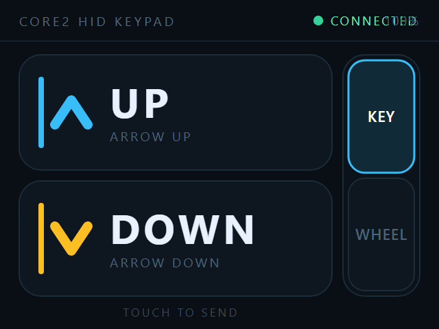

# Core2Keypad

把 **M5Stack Core2** 变成一只「只有两个键」的 BLE 输入设备：屏幕上是两个触摸键，右侧一条竖排开关切换这两个键**发什么**。



## 两种模式

| 模式 | 上键 / 下键发送 | 适合 |
| --- | --- | --- |
| **KEY** | `↑` / `↓` 方向键 | 文本编辑、光标移动、列表导航 |
| **WHEEL** | 鼠标滚轮 上 / 下 | 抖音这类竖屏信息流、网页滚动、阅读器翻页 |

点右侧 `KEY` / `WHEEL` 即时切换，选择写在 NVS 里，断电保留。

**为什么需要 WHEEL**：抖音的竖屏流是触摸翻页容器，全屏播放器没有可聚焦控件，系统在触摸模式下会丢弃硬件方向键；
滚轮属于通用滚动事件，列表控件普遍响应。所以方向键在编辑器里好使、在抖音里不好使是正常现象，换个输出类型即可。

## 快速开始

```bash
pio run -t upload        # 默认 COM6，921600
```

### 配对

| 系统 | 操作 |
| --- | --- |
| Windows | 设置 → 蓝牙和其他设备 → 添加设备 → 蓝牙 → **Core2 Keypad** |
| macOS | 系统设置 → 蓝牙 → 点 **Core2 Keypad** 连接 |
| Android | 设置 → 蓝牙 → 配对新设备 → **Core2 Keypad** |
| iOS/iPadOS | 设置 → 蓝牙 → **Core2 Keypad** |

> **改过 HID 报告描述符后必须重新配对一次。** 主机（尤其 Windows、Android）会缓存上一次的描述符；
> 不重新配对的话，新加的滚轮接口不会被系统加载。做法：先在系统里「忘记/删除设备」，再重新配对。

## 屏幕几何

`docs/prototype.svg` 是唯一事实来源，`src/main.cpp` 顶部常量与它一一对应：

| 常量 | 值 | 含义 |
| --- | --- | --- |
| `BTN_X` / `BTN_W` | 14 / 228 | 两个按钮的左边界与宽度（让出右侧 56px 给开关） |
| `UP_Y` / `DOWN_Y` | 40 / 132 | 按钮顶边，高 84，中心 82 / 174 |
| `ACCENT_X` / `ACCENT_W` / `ACCENT_H` | 28 / 4 / 52 | 左侧色标 |
| `CHEV_CX` / `CHEV_HW` / `CHEV_HH` | 52 / 12 / 9 | 箭头中心与半宽半高（围盒 73–91、165–183，居中于按钮） |
| `LABEL_X` | 80 | 文字左边界 |
| `RAIL_X` / `RAIL_Y` / `RAIL_W` / `RAIL_H` | 250 / 40 / 56 / 176 | 右侧开关外框 |
| `SEG_KEY_Y` / `SEG_WHEEL_Y` | 44 / 130 | 两段开关的顶边，各 48×82 |

## 串口调试（921600）

| 命令 | 作用 |
| --- | --- |
| `C2_INFO` | 版本、分辨率、当前模式、连接状态 |
| `C2_BLE` | BLE server / HID 服务句柄 / 连接状态 |
| `C2_CCCD` | 两个输入报告的订阅位（`kb=` / `ms=`，`0100` 才算已订阅） |
| `C2_SCREEN` | 整屏 RGB888 截图（`tools/c2_screenshot.py` 存 PNG） |
| `C2_MODE` | 在 KEY / WHEEL 之间切换 |
| `C2_SETMODE <0\|1>` | 直接指定模式（0=KEY，1=WHEEL） |
| `C2_TOUCH <x> <y>` | 命中测试，返回 `UP`/`DOWN`/`MODE_KEY`/`MODE_WHEEL`/`NONE` |
| `C2_REPORTID <0\|1>` | 报告值是否带 Report ID 前缀（默认 0，必须为 0 才能正常打字） |
| `C2_NOTCHES <1..40>` | 滚轮一次按压发几格（默认 8），翻页幅度不够就调大 |
| `K_UP` / `K_DOWN` | 不用手指，按当前模式直接发一次 |

### 端到端验证（Windows）

```bash
pwsh tools/c2_hid_probe.ps1 -Reset
```

挂全局键盘钩子 → 硬重置板子 → 等它自动重连 → 串口发 `K_UP`/`K_DOWN`，最后判定 Windows
是否真的收到 `↑`/`↓`（退出码 0 = 通过）。改完连接相关代码、或怀疑「重连后没反应」时先跑这个，
比盯着屏幕猜快得多。

## 实现要点

- **HID 复合设备**（规范写法，报告值首字节是 Report ID）：
  - `ID 1` 键盘 9 字节 `[id, modifiers, reserved, key1..key6]`
  - `ID 2` 鼠标 5 字节 `[id, buttons, dx, dy, wheel]`
- **滚轮强度**：一次按压发 `WHEEL_NOTCHES = 8` 个刻度（每个刻度一份独立报告，间隔 6 ms），
  模拟真实滚轮的多格滚动。抖音不翻页或翻过头，就改这个常量。
- **渲染**：全部画在 320×240 的 `M5Canvas` 上再 `pushSprite`，截图直接取这块内存；
  注意 M5GFX 的 16bpp sprite 是 **swap565** 存储，取字节要先交换，否则红蓝会互换。
- **内存顺序**：先分配帧缓冲再 `BLEDevice::init()`，反了 sprite 会分配失败。
- **订阅状态持久化**：输入报告的 CCCD 落 NVS，重连时回填；不做这一步，reset 之后
  `notify()` 会静默丢弃所有报告（详见下面的踩坑记录）。

## 已验证

| 验证项 | 结果 |
| --- | --- |
| 键盘上报（KEY） | Windows 全局钩子捕获 `DOWN vk=38`（↑）/ `DOWN vk=40`（↓）及其抬起 |
| 滚轮上报（WHEEL） | 设备侧 `[KEY] press UP mode=WHEEL conn=1`，8 个通知全部发出 |
| 模式开关 | `C2_TOUCH 278 85 → MODE_KEY`、`278 171 → MODE_WHEEL`；切换即时生效并落盘 |
| 按钮命中 | `(160,80)→UP`、`(160,190)→DOWN`、`(160,128)` 间隙→`NONE` |
| 系统识别 | Windows PnP 出现 `HIDClass` + `Keyboard / HID Keyboard Device` |
| reset 后重连 | 连按 reset 多次：`C2_CCCD kb=0100 ms=0100`，按键照常到达，无需重新配对 |

## 踩坑记录：Report ID 该不该放进报告值

HOGP 规范写的是「描述符里有 Report ID 项时，报告值首字节应为 Report ID」。我第一版按规范发了
9 字节（首字节 `0x01`），结果手机侧**键盘直接失灵**：Android 的主机栈把特征值整体当作报告本体，
多出来的 `0x01` 被解释成修饰键（Ctrl），后面全部错位。

结论：**发不带 Report ID 的裸报告**（键盘 8 字节、鼠标 4 字节），报告类型由特征本身区分。
这与改动前那版能正常打字的实现一致。

`C2_REPORTID 1` 可以切回带 ID 的写法做对比实验，但默认必须是 0。

## 踩坑记录：主机缓存了旧的 HID 描述符

改过报告描述符后，主机（Android / Windows）会按**蓝牙地址**缓存这份描述符和特征句柄。
如果只是删配对再配对，缓存往往还在，于是出现最迷惑的现象：

- 设备侧 `connected=1`、`[SEC] auth OK bonded=1`、`notify()` 正常返回；
- 手机侧 `dumpsys bluetooth_manager` 显示 `HIDH Opened`、`Encryption success`、`ready:T`；
- 但 `getevent` 一个事件都没有，输入设备的名称还是旧描述符的产物
  （有 `Keyboard` + `Consumer Control`，没有 `Mouse`）。

**解决办法**：让板子换一个蓝牙地址，主机就会当成全新设备重新读描述符。
固件在 `setup()` 开头从出厂 base MAC 派生一个稳定地址（`base[5] ^= 0x01`，
BT MAC = base + 2），重启不会变：

```cpp
uint8_t baseMac[6];
esp_efuse_mac_get_default(baseMac);
baseMac[5] ^= 0x01;
esp_base_mac_addr_set(baseMac);
```

当前地址：**`5C:01:3B:0C:B9:23`**（出厂 BT MAC 是 `…B9:22`）。
换地址后要在主机上把旧设备删掉，重新配对一次。

## 亮度自动变暗

省电又不会一直亮着刺眼：

| 时机 | 行为 |
| --- | --- |
| 开机 | 100% 满亮 |
| 空闲满 **3 秒** | 在 **1 秒**内线性降到 **20%** |
| 任何触摸 | 立即回到 100%，并重新开始 3 秒计时 |

实现是非阻塞的，在 `loop()` 里按 `millis()` 推进，不占用触摸/按键处理：

```cpp
const uint32_t idle = millis() - g_lastInputMs;
if (idle <= kHoldMs) { applyBrightness(kBrightMax); return; }        // 保持满亮
const uint32_t e = idle - kHoldMs;
if (e >= kFadeMs) { applyBrightness(kBrightDim); return; }           // 已到 20%
applyBrightness(kBrightMax - span * e / kFadeMs);                    // 线性插值
```

`kBrightMax = 255`、`kBrightDim = 51`（20%）、`kHoldMs = 3000`、`kFadeMs = 1000` 都集中在
`src/main.cpp` 顶部附近，改数值即可。亮度变化会打 `[BRI] <值> t=<ms>`，串口可直接量时序。

## 电源键

按一下侧边电源键：屏幕立刻熄灭并调用 `M5.Power.powerOff()`，由 AXP 切断各路电源；再按一次由 AXP
硬件上电开机（等同一次冷启动，会重新走配对流程）。

```cpp
if (M5.BtnPWR.wasClicked()) {
    M5.Display.setBrightness(0);
    delay(150);
    M5.Power.powerOff();
}
```

这不是 ESP32 的 `deep_sleep`：Core2 的电源键挂在 AXP 的 PWRKEY 上、不在 RTC GPIO 上，深度睡眠无法被它
唤醒，所以走 AXP 断电这条更可靠的路。

## 踩坑记录：reset 之后主机还显示「已连接」，但按键全没反应

**现象**：Core2 一按 reset（或 AXP 断电重启），PC / 手机上的蓝牙状态仍是「已连接」，
设备屏幕也显示 `CONNECTED`，但无论怎么点、怎么发，主机一个按键都收不到。
串口看设备侧一切正常：

```
[BLE] connected
[SEC] auth OK bonded=1
[KEY] press UP mode=KEY conn=1          ← 设备认为自己发了
C2_CCCD kb=0000 ms=0000 conn=1 peers=1  ← 但两个输入报告的订阅位都是 0
[HID] kb DROP cccd-not-subscribed       ← notify() 在真正发送之前就丢弃
```

**根因**：HOGP 的输入报告只在主机订阅后才能发，订阅状态就是报告特征下的
CCCD（`0x2902`）值。蓝牙规范（Core 3.G §3.3.3.3）要求**外设替已绑定主机记住这个值**，
所以 Windows / Android / iOS 重连时**不会重写 CCCD**，它们默认外设还记着。
但 ESP32 的 CCCD 只活在 RAM 里，`BLEDevice::init()` 一跑就归零；而 Arduino BLE 的
`BLECharacteristic::notify()` 会先检查本地 0x2902，为 0 就直接 return，**不报错、不打印**。
于是链路、加密、句柄全都正常，报告却全被静默吞掉 —— 主机侧自然是「连着但没反应」。
这也是之前「每次重启要删设备重配对」说法的真正原因。

**修复**：把订阅状态落 NVS，连接建立时回填（`src/main.cpp` 的 `cccdRestore()`）：

- `CccdCB::onWrite()`：只有主机真正写 0x2902 时才 `putChar`，避免开机默认值把记录冲掉；
- `ServerCB::onConnect()`：读回记录并 `setValue({0x01,0x00})`，同时写进协议栈属性表；
- 没记录过时按「有绑定即已订阅」处理 —— 配对过的主机必然开过通知；
- 主机显式退订（写 0）则尊重 0，不会硬顶回去。

**验证**：重置后 `C2_CCCD kb=0100 ms=0100`，Windows 全局键盘钩子收到
`DOWN vk=38`（↑）/ `DOWN vk=40`（↓）；连续 reset 多次都成立，无需重新配对。

## 已知限制

- 未做加密绑定（Just Works 直连），公共同环境里别人也能连上并按键。
- 一次只服务一台主机；换设备需先在原主机断开。
- 滚轮能否驱动某个 App，取决于该 App 是否响应通用滚动事件；不响应时只能改用触摸手势类方案。
- 电池百分比来自 AXP，USB 供电时显示虚高的 100%。
