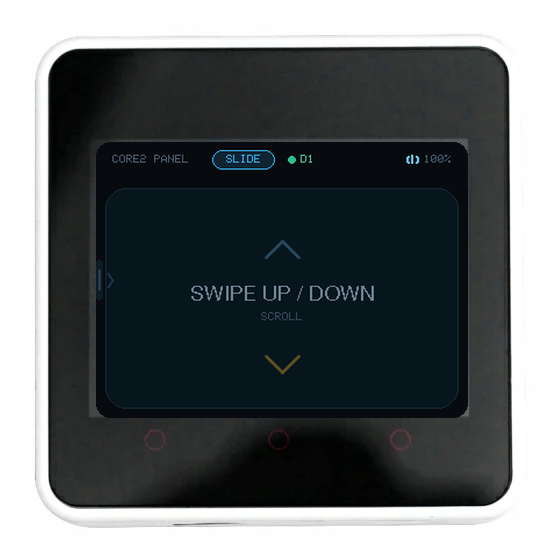
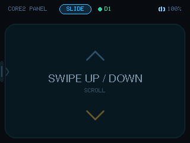
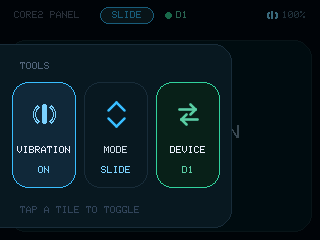
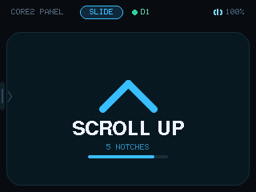
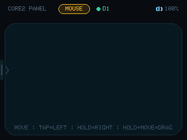

# Core2Keypad

把 M5Stack Core2 当成一块蓝牙触控板：整屏都是操作区，没有实体按键。
上下滑输出滚轮，按住再拖就是鼠标；左侧抽屉里切模式、开关振动，还能在三台同时连接的主机之间切换。



[English](README.md)

## 两个模式

| 模式 | 上下滑 | 单击 | 按住 500ms | 按住 ~0.3s 再拖 |
| --- | --- | --- | --- | --- |
| **SLIDE** | 滚轮：下滑向上滚、上滑向下滚（自然滚动） | — | — | — |
| **MOUSE** | 移动光标 | 左键 | 右键 | 左键拖拽（选中文字、拖窗口） |

每 24px 一格滚轮、单次最多 12 格，边滑边发；滑完提示停留 3 秒。
鼠标灵敏度：**1 屏幕像素 ≈ 1.2 个鼠标计数**。

> 「拖拽」和「移动光标」靠按下后的停顿区分：按下去立刻划只移光标，按住约 0.3 秒再划就是按住左键拖动，抬手松开。

## 工具栏

从屏幕左缘（x < 16）向右滑 ≥ 60px 拉出抽屉：

- **VIBRATION** — 振动开关，点亮 = 开
- **MODE** — SLIDE / MOUSE，颜色跟着模式走（蓝 = 滑动，琥珀 = 鼠标）
- **DEVICE** — 当前主机槽位 `D1/D2/D3`，点亮 = 该槽在线；**点一下循环**

三块都是 64×106，整块可点；点块切换、点抽屉外收起，状态全部写 NVS，重启保留。
振动开着时，滚动 / 左键 / 右键各给一次 40ms 短震，状态条电量左侧常驻一个小图标。

## 多设备（3 个槽位）

ESP32 的 BLE 控制器同时只支持 **3 条连接**（`CONFIG_BTDM_CTRL_BLE_MAX_CONN=3`），所以固定 3 个槽位：

- 槽位按**蓝牙地址**记忆（NVS），重启 / 深睡唤醒后映射与选择都保留
- `DEVICE` 显示当前槽位，**点一下循环**：D1 → D2 → D3 → D1
- **只有当前槽位收到报告**，其它连接保持不断——切换从不 disconnect
- 状态条恒显 `● D<n>`：绿 = 该槽在线、琥珀 = 该槽离线但还有别的在线、灰 = 一台都没连
- 空槽或离线槽静默丢弃报告，不会自动跳到别的设备
- 第二、三台设备连进来会占空闲槽位；三槽占满时淘汰不在线且最久没用的那个

## 截图

| 滑动模式（空闲） | 抽屉：VIBRATION / MODE / DEVICE |
| --- | --- |
|  |  |

| 滑动中（滚轮提示，3 秒后隐去） | 鼠标模式 |
| --- | --- |
|  |  |

## 屏幕

状态条依次是标题、模式徽标（蓝 SLIDE / 琥珀 MOUSE）、当前主机槽位 `● D1` 和电量；振动开着时电量左侧多一个小图标。

- 面板底部提示手势，滑动时替换成方向、格数和进度条，3 秒后自动隐去
- 空闲 3 秒亮度降到 20%，一碰立刻回满
- 无动作 5 分钟关屏降频，再 5 分钟进入 deep sleep，触摸即醒
- 侧边电源键短按立刻 deep sleep，长按仍是 AXP 硬件关机

## 串口命令（921600）

| 命令 | 作用 |
| --- | --- |
| `C2_INFO` | 版本、模式、振动、连接数、槽位、抽屉状态、开机次数、uptime |
| `C2_BLE` | BLE server、HID 服务句柄、连接状态 |
| `C2_CCCD` | 两个输入报告的订阅位（`0100` = 已订阅） |
| `C2_MODE <0\|1>` | 0 = SLIDE，1 = MOUSE |
| `C2_VIB <0\|1>` | 振动开关 |
| `C2_BUZZ` | 手动震一下；`ok=1` 说明马达在线 |
| `C2_DISC` | 断开当前槽位的链路（测重连） |
| `C2_HOSTS` | 列出在线连接：conn / 槽位 / 地址 / 是否当前槽位 |
| `C2_HOST <1\|2\|3>` | 直接切到某个槽位 |
| `C2_T <0\|1> <x> <y>` | 注入触摸；`C2_T 9` 交还真实触摸 |
| `C2_SCREEN` | 整屏 RGB888 截图（`tools/c2_screenshot.py` 存 PNG） |
| `C2_SLEEP` | 立即进入第一段睡眠 |
| `C2_DEEPSLEEP` | 立即进入 deep sleep |

## 端到端验证

```bash
pwsh tools/c2_e2e.ps1
```

挂 Windows 鼠标 API，用 `C2_T` 注入触摸，断言滚轮、点击、移动、抽屉切换、槽位循环和主机路由——共 17 项。

## 已验证

| 项 | 结果 |
| --- | --- |
| 滑动 · 上滑 140px → 向下滚 | 5 × `WHEEL -120` |
| 滑动 · 下滑 140px → 向上滚 | 5 × `WHEEL +120` |
| 鼠标 · 单击 | `LBUTTON_DOWN` / `LBUTTON_UP` |
| 鼠标 · 长按 700ms | 500ms 时 `RBUTTON_DOWN` / `RBUTTON_UP` |
| 鼠标 · 拖动 | 连续 `MOVE` |
| 鼠标 · 按住后拖动 | `LBUTTON_DOWN` + `MOVE` ×2 + `LBUTTON_UP` |
| 左缘右滑 | 抽屉打开，无鼠标事件泄漏 |
| 抽屉 | 振动开关、模式切换、DEVICE 循环 D1 → D2 → D3 |
| 点抽屉外 | 收起 |
| 振动马达 | `C2_BUZZ ok=1` |
| 持久化 | 模式、振动、槽位重启后保留 |
| 掉线恢复 | `C2_DISC` 后 2 秒内主机自动重连 |
| 滚动提示 | 最后一格后 3 秒隐去 |
| 睡眠 / 唤醒 | `C2_SLEEP` 后 `asleep=1`，触摸回到 0 |
| deep sleep | 串口静默，RTS 复位可恢复 |
| 多设备 · 切到空槽 | 主机收到 0 个按键事件 |
| 多设备 · 切回原槽 | `LBUTTON_DOWN` 恢复 |

## 已知限制

- 未做加密绑定（Just Works），附近的人也能连上并操作
- 最多 3 台主机同时在线，第 4 台会被控制器拒绝
- 槽位只能用「第几台」区分，BLE 外设拿不到主机名
- 滚轮能否驱动某个 App，取决于它是否响应通用滚动事件
- 振动只有开关（AXP192 LDO3 固定 1800mV），没有强度分级
- 双指手势不可用：面板只上报一个触点
- deep sleep 唤醒是冷启动，屏幕约 1.5 秒亮、蓝牙约 5 秒回来
